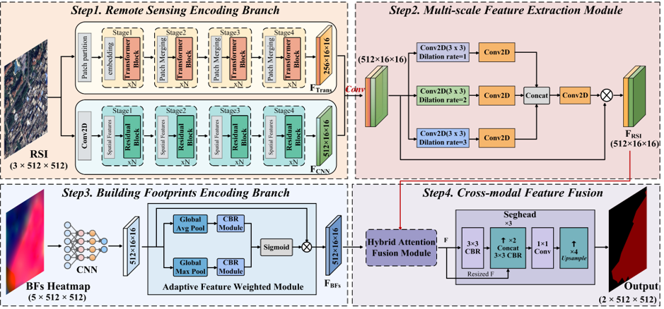
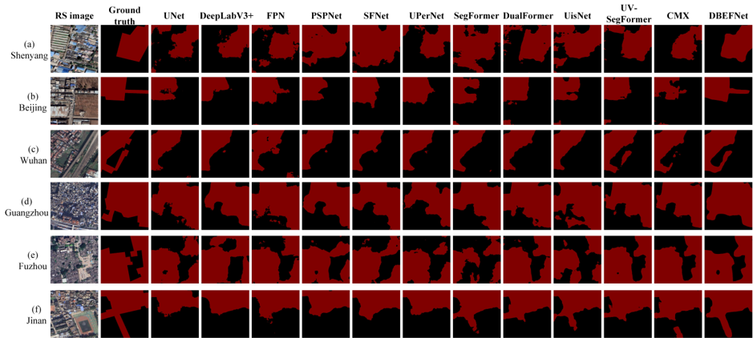

# DBEFNet

PyTorch implementation of **DBEFNet: A Dual-Branch Fusion Network integrating remote sensing imagery and building morphology for urban village segmentation**.

DBEFNet combines remote sensing imagery and building morphology for urban village segmentation. The imagery branch uses parallel CNN and Swin Transformer streams to encode visual appearance and context. The building branch encodes five morphology layers and adaptively weights their features. A hybrid attention fusion module connects the two modalities before a progressive segmentation head produces pixel-level predictions.

This repository includes the network architecture and training, evaluation, and prediction code for prepared image–building pairs.

Prepared pairs are supplied by the user; this repository does not ship the manuscript dataset.



## Installation

Install the dependencies in a Python environment compatible with the pinned packages. Run the commands below from the repository root.

```bash
pip install -r requirements.txt
```

## Data preparation

The loader expects aligned GeoTIFF patches organized as follows. Use the split names corresponding to your dataset; they are configurable in the commands and configuration file.

```text
datasets/CUGUV/
  train/
    rs/        # city_001_rs.tif
    building/  # city_001_building.tif
    label/     # city_001_label.tif
  val/
    rs/
    building/
    label/
  test/
    rs/
    building/
    label/     # required for evaluation; omitted for prediction
```

- Image, building, and label filenames must share the same city name and numeric sample identifier.
- RGB imagery must use unsigned 8-bit values in the first three bands. The loader applies ImageNet RGB normalization (`mean=(0.485, 0.456, 0.406)`, `std=(0.229, 0.224, 0.225)`).
- Building rasters must contain five bands in this order: density, area, nearest-neighbor distance (NND), height, and footprint. Prepare the first four bands in the range [0, 1]; the footprint band must be binary (0/1).
- Each paired sample must share the same coordinate reference system, transform, and pixel grid. Patches must match `input_shape` (512 × 512 by default); the loader does not resize or reproject them.
- The default label encoding is `01`: 0 = background, 1 = urban village, and 255 = ignore. For binary labels encoded as 0/255, set `--label_encoding 0255`; 255 then denotes urban village.

## Usage

### Training

1. Edit [`configs/dbefnet_cuguv.yaml`](configs/dbefnet_cuguv.yaml) (or pass CLI overrides) so `dataset_dir`, split names, and hyperparameters point at your prepared data.
2. Ensure the train and validation splits use **disjoint sample identifiers**. The trainer raises an error if they overlap.
3. Choose an **empty** `--output_dir` (default `outputs/DBEFNet`). Training refuses to start if the directory already contains files.
4. Run:

```bash
python train.py --config configs/dbefnet_cuguv.yaml
```

What training does:

- Builds `DBEFNet`, optimizes with **AdamW**, and applies a **polynomial LR schedule** (power 0.9) that steps **once per training batch**.
- Applies synchronized geometric augmentation (horizontal flip, vertical flip, 90° rotations) across RGB, building morphology, and labels; ColorJitter (0.2 / 0.2 / 0.2 / 0.05) is applied to RGB only.
- Each epoch evaluates on the validation split. Checkpoint selection and early stopping use **validation mIoU**.
- Writes `config.json`, `history.csv`, `last_checkpoint.pth`, and atomically saves `best_checkpoint.pth` (write `.tmp` then `os.replace`) whenever validation mIoU improves.
- Stops early after `--patience` epochs (default 50) without a validation mIoU improvement.

Use the validation split only for model selection. Keep a separate held-out test split for final numbers. The directory layout above describes the interface, not the manuscript's sample allocation.

### Evaluation

Evaluate a trained checkpoint on a held-out split (labels required):

```bash
python train.py --only_evaluate \
  --dataset_dir datasets/CUGUV \
  --eval_split test \
  --checkpoint outputs/DBEFNet/best_checkpoint.pth \
  --output_dir outputs/evaluation
```

- `--only_evaluate` loads weights from `--checkpoint` and runs inference on `--eval_split` without updating parameters.
- Results are written to `metrics.json` under `--output_dir` with `"units": "fractions"`: confusion matrix, per-class precision / recall / F1 / IoU, and their arithmetic means (macro metrics and mIoU).
- Prefer evaluating the saved `best_checkpoint.pth` on a split that was **not** used for early stopping or model selection.

### Prediction

Prediction needs paired image and building rasters **without** labels:

```bash
python predict.py \
  --dataset_dir datasets/CUGUV \
  --split test \
  --checkpoint outputs/DBEFNet/best_checkpoint.pth \
  --save_dir outputs/predictions
```

Outputs are georeferenced 0/1 masks (`{sample_id}_pred.tif`). Add `--save_overlay` to also save RGB overlays. The default device is CUDA when available, otherwise CPU; use `--device cpu` to force CPU.

## Default training hyperparameters

Values mirror [`configs/dbefnet_cuguv.yaml`](configs/dbefnet_cuguv.yaml) and the training / dataloader defaults. Override any of them on the command line or by editing the YAML file.

| Setting | Default |
|:--|--:|
| Input size | 512 × 512 |
| Batch size | 4 |
| Epochs | 100 |
| Early-stopping patience | 50 (on validation mIoU) |
| Optimizer | AdamW |
| Learning rate | 1e-4 |
| Weight decay | 0.01 |
| LR schedule | Polynomial decay, power 0.9 (per-batch) |
| Loss | Focal + Dice + CE (weights 1.0 / 1.0 / 1.0) |
| Focal α / γ | 0.75 / 2.0 |
| Ignore index | 255 |
| Max grad norm | 1.0 |
| DataLoader workers | 4 |
| Label encoding | `01` (or `0255`) |
| Train augmentation | Synced HFlip / VFlip / 90° rotation; ColorJitter 0.2/0.2/0.2/0.05 on RGB only |
| RGB normalize | ImageNet mean/std |
| Building bands | density, area, NND, height in [0, 1]; binary footprint |
| Device | `auto` (CUDA if available, else CPU) |
| Output directory | `outputs/DBEFNet` |

## Model complexity

Default `DBEFNet()` has **95.47M** trainable parameters (counted from `sum(p.numel() for p in DBEFNet().parameters())` on the code in this repository). The network uses dual ResNet-34 encoders (imagery CNN stream and building morphology stream) plus a Swin Transformer on the imagery branch (embed dims 96 / 192 / 384 / 768, depths 2 / 2 / 6 / 2, heads 3 / 6 / 12 / 24, window size 7). Features are fused by MFEM / AFWM / HAFM (8 attention heads) and decoded by a reinjection segmentation head. See the architecture table below for per-module tensor shapes. FLOPs, peak memory, and inference speed depend on hardware and are not reported here.

## Reproducibility

- Training and validation sample identifiers must be disjoint.
- Validation is used only for checkpoint selection by mIoU and early stopping.
- Report final numbers on a held-out test split that is not used for model selection.
- Evaluation writes metrics as fractions in `metrics.json` (confusion matrix and per-class / macro scores).
- `best_checkpoint.pth` is written atomically (temporary file then replace) when validation mIoU improves.

## Repository structure

| Path | Description |
|:--|:--|
| [nets/DBEFNet.py](nets/DBEFNet.py) | DBEFNet, MFEM, AFWM, HAFM, and segmentation head |
| [nets/backbone.py](nets/backbone.py) | ResNet-34 and Swin feature encoders |
| [nets/swin_transformer.py](nets/swin_transformer.py) | Swin Transformer components |
| [train.py](train.py) | Training and evaluation |
| [predict.py](predict.py) | Prediction and output saving |
| [dbefnet.py](dbefnet.py) | Batch prediction interface |
| [configs/dbefnet_cuguv.yaml](configs/dbefnet_cuguv.yaml) | Default training configuration |
| [utils/](utils/) | Data loading, metrics, and checkpoint utilities |
| [assets/architecture.png](assets/architecture.png) | DBEFNet architecture figure |
| [assets/qualitative_comparison.png](assets/qualitative_comparison.png) | Qualitative comparison figure |

## Model architecture

The imagery encoder combines ResNet-34 features with top-down aggregation of Swin stages 2–4, then projects the concatenated 768-channel map to 512 channels. The building encoder accepts five morphology channels. MFEM, AFWM, and HAFM extract and fuse the two modalities, followed by a segmentation head that reintroduces the HAFM feature at successive decoding scales. ResNet-34 is instantiated through TorchVision, and the Swin implementation is included in this repository.

| Component | Implementation | Output for a 512 × 512 patch |
|:--|:--|:--|
| CNN stream | ResNet-34 C5 feature | `B × 512 × 16 × 16` |
| Transformer stream | Four Swin stages; top-down aggregation of S2–S4 produces a 256-channel map | `B × 256 × 16 × 16` |
| RSI encoder | Concatenate CNN and Transformer streams (768 channels), then apply 1 × 1 Conv–BN–ReLU | `B × 512 × 16 × 16` |
| MFEM | Three convolution branches with dilation rates 1, 2, and 3; fusion, attention, and residual addition | `B × 512 × 16 × 16` |
| Building encoder + AFWM | Five-channel ResNet-34; average/max pooled descriptors produce channel weights | `B × 512 × 16 × 16` |
| HAFM | Two cross-attention paths and one building self-attention path, each with 8 heads; convolutional fusion and channel refinement | `B × 512 × 16 × 16` |
| Segmentation head | Produce 256 channels at 16²; restore 32²/64²/128² while re-injecting the original 512-channel HAFM map; classify and resize ×4 | `B × 2 × 512 × 512` |

## Results

Comparison on the held-out test split used in the manuscript. Values are percentages. Precision and F1 are macro averages over the background and urban-village classes. **RSI** = remote-sensing imagery; **Morph-5** = five building-morphology bands.

| Model | Input | OA (%) | mIoU (%) | Precision (%) | F1 (%) |
|:--|:--|---:|---:|---:|---:|
| UNet | RSI | 92.33 | 80.63 | 88.86 | 88.94 |
| DeepLabV3+ | RSI | 91.36 | 77.86 | 88.59 | 87.06 |
| FPN | RSI | 92.32 | 80.92 | 88.38 | 89.14 |
| PSPNet | RSI | 91.63 | 78.49 | 88.92 | 87.49 |
| SFNet | RSI | 91.48 | 78.71 | 87.76 | 87.67 |
| UPerNet | RSI | 91.95 | 79.53 | 88.78 | 88.20 |
| SegFormer | RSI | 91.99 | 79.88 | 88.36 | 88.45 |
| DualFormer | RSI | 93.71 | 83.89 | 90.58 | 91.02 |
| UisNet | RSI + building footprint and area | 91.94 | 79.81 | 88.29 | 88.41 |
| UV-SegFormer (adapted) | RSI + Morph-5 | 94.01 | 84.53 | 91.14 | 91.41 |
| CMX (adapted) | RSI + Morph-5 | 93.87 | 83.85 | 91.84 | 90.97 |
| **DBEFNet** | **RSI + Morph-5** | **94.79** | **86.24** | **92.62** | **92.45** |



*Qualitative comparison on representative test patches from Shenyang, Beijing, Wuhan, Guangzhou, Fuzhou, and Jinan.*

## License and acknowledgments

See [LICENSE](LICENSE) and [THIRD_PARTY_NOTICES.md](THIRD_PARTY_NOTICES.md) for license terms and third-party attribution.
